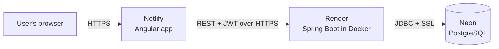

# TaskFlow: How I Deployed a Full-Stack App to the Internet

TaskFlow is a task management web app built with **Angular**, **Spring Boot** and **PostgreSQL**. This document tells the full deployment story: database, backend and frontend, all on free tiers, with the problems I hit and how I fixed them.

| Part | Service | Region | Link |
|---|---|---|---|
| Frontend (Angular) | Netlify | Global CDN | https://taskfloooow.netlify.app |
| Backend (Spring Boot, Docker) | Render | Singapore | https://taskflow-backend-dar5.onrender.com |
| Database (PostgreSQL) | Neon | AWS Singapore | private |

Health check: https://taskflow-backend-dar5.onrender.com/actuator/health

## Architecture

The browser downloads the Angular app from Netlify. The app then calls the Spring Boot API on Render, which reads and writes data in Neon. Each part is deployed on its own and connected only through URLs and environment variables.

## The deployment order

The order matters, because each step needs a value from the one before it.

1. **Database first.** The backend needs a database URL to start.
2. **Backend second.** The frontend needs the live API URL.
3. **Frontend third.** The backend then needs the frontend URL for CORS.
4. **Update CORS last.** This closes the loop.

## Step 1: Database on Neon

1. Created a Neon project in **AWS Asia Pacific (Singapore)**, the region closest to me.
2. Copied the connection string and split it into three values for Spring Boot:
   - `DATABASE_URL`: `jdbc:postgresql://<host>/<database>?sslmode=require` (note the `jdbc:` prefix and no credentials inside it)
   - `DATABASE_USERNAME`
   - `DATABASE_PASSWORD`
3. Left the database empty. **Flyway migrations** create the tables automatically the first time the backend starts.

## Step 2: Backend on Render

1. Added a multi-stage **Dockerfile**: Maven builds the jar in the first stage, and a slim Java runtime runs it in the second.
2. Pushed the repo to GitHub and created a **Web Service** on Render (Docker runtime, Singapore, free instance).
3. Set environment variables in Render. No secret is stored in the repo:

   | Variable | Purpose |
   |---|---|
   | `DATABASE_URL`, `DATABASE_USERNAME`, `DATABASE_PASSWORD` | Neon connection |
   | `JWT_SECRET` | A new random secret generated for production |
   | `SPRING_PROFILES_ACTIVE` | `prod` |
   | `CORS_ALLOWED_ORIGINS` | The frontend's URL |

4. Set the health check path to `/actuator/health`.

## Step 3: Frontend on Netlify

1. Put the live API URL in Angular's production `environment.ts`.
2. Added a `_redirects` file (`/*  /index.html  200`) so refreshing on routes like `/dashboard` doesn't return a 404.
3. Connected the GitHub repo to Netlify. Netlify runs `ng build` itself, so `dist/` never needs to be committed.
4. Copied the Netlify URL into `CORS_ALLOWED_ORIGINS` on Render.

## What I kept out of GitHub

Both repositories are public, so before pushing I made sure of the following:

- Database credentials and the JWT secret live only in Render's environment variables and in a git-ignored local file.
- Local settings go in `application-local.properties`, which is in `.gitignore`. A committed `.example` template shows the shape without real values.
- The production JWT secret is different from the one used locally.
- The frontend contains only the public API URL. Nothing in a browser app can be secret.

## Problems I hit and how I fixed them

| Symptom | Cause | Fix |
|---|---|---|
| `UnknownHostException` when connecting to Neon | A stray space before the hostname in the URL | Removed the space |
| `'url' must start with "jdbc"` on Render | The database URL variable didn't reach Spring in the right format | Corrected the variable so the value starts with `jdbc:postgresql://` |
| Browser showed "no backend running"; the preflight `OPTIONS` request returned **403** | The allowed origin was hardcoded as `http://localhost:4200` in the CORS config, so the Netlify origin was rejected | Read the allowed origins from the `CORS_ALLOWED_ORIGINS` environment variable |
| `Invalid CORS request` from `curl` | The `Origin` header didn't match the configured origin exactly | Found it with `curl` using different `Origin` values, then matched the real site URL exactly |

**Lesson:** a browser's CORS error and a "server down" message can look identical. Testing the preflight with `curl -X OPTIONS` and a chosen `Origin` header showed exactly which side was rejecting the request.

## Free-tier behavior to expect

- **Render** puts the service to sleep after about 15 minutes idle. The first request afterwards can take 30 to 60 seconds.
- **Neon** pauses an idle database, so the first query after a break can be slow.
- Both wake up automatically. Open the health link before a demo.

## How updates reach production

Pushing to GitHub is the whole release process:

- Push the backend repo and Render rebuilds the Docker image and redeploys.
- Push the frontend repo and Netlify rebuilds and publishes.

## Possible next steps

- GitHub Actions to run tests on every push
- Backend unit and integration tests
- Rate limiting on the auth endpoints
- A custom domain